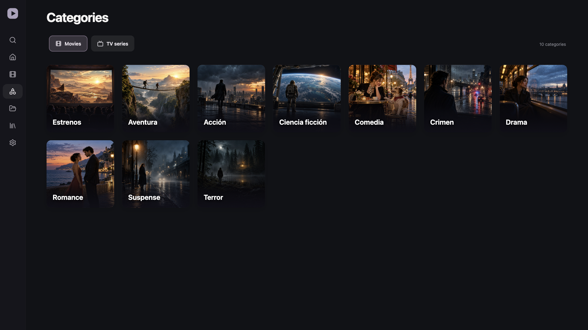

# Pelisflix for Android and Google TV

Pelisflix is a client for browsing and watching titles from Pelisflix, Pelisforte and Fuegocine. It works on Android phones, tablets, Android TV and Google TV, with touch controls on handheld devices and remote navigation on television.

[Download the latest APK](https://github.com/lastrowcritic/pelisflix-android/releases/latest)



## Features

- Browse films, series, genres and collections.
- Switch between Pelisflix, Pelisforte and Fuegocine in Settings. Saved titles and Continue watching open with the source they came from.
- Hide titles that cannot be played in Castellano.
- Search with a TV keyboard or your phone keyboard.
- Choose audio, seasons and episodes.
- Resume at the saved episode and minute, with a separate position for each episode.
- Remember each title's audio choice.
- Use native playback with ten-second seeking, quality controls and subtitles when available.
- Save a watchlist and viewing history on the device.
- Optionally sync your viewing history between devices with a server you host yourself.
- Reuse cached catalog pages, title details and artwork.
- Choose a mirror and keep the same viewing history when the domain changes.
- Check GitHub for future app updates from Settings.

## Install

Download the APK from Releases and open it on your Android device. On a TV, transfer the APK to a file manager or install it from a computer with `adb install Pelisflix-0.1.2.apk`.

The app requires Android 7.0 or newer.

## Source availability

The app reads source pages and explicitly supported video providers. It extracts player data without executing advertising scripts. It does not host or distribute video files.

Some source links can be unavailable or removed even when a title remains in the catalog. The app checks media before playback and shows a useful error for removed files. Ratings are shown only when real rating data is available; the sampled source pages did not provide IMDb scores.

The working mirror domains during testing were pelisflix1.dog and pelisflix200.dog. Additional supplied domains are bundled, including aliases that redirect to those domains. Availability can vary by network.

## Build

Use Node.js 24, Java 21 or 24, and the Android SDK with Platform 36. Set `ANDROID_HOME` to your SDK directory, then run:

```sh
npm ci
npm run android:build
```

This produces a debug APK by default. For a release build, set `PELISFLIX_KEYSTORE`, `PELISFLIX_KEYSTORE_PASSWORD`, `PELISFLIX_KEY_ALIAS` and `PELISFLIX_KEY_PASSWORD` before running the build command. Keep the signing key outside the repository and use the same key for future updates.

## Mac preview and testing

```sh
npm ci
npm run dev
```

Open the local address printed by Vite. Use arrow keys, Enter and Escape to test TV navigation. The preview includes local content and media transport. Website verification that needs native browser support is handled by the Android app.

```sh
npx tsc --noEmit -p .
npm test
```

To run the optional live source tests, keep the preview running on port 5181:

```sh
npm run dev -- --port 5181
npm run test:live
```

`npm run tv` starts the Android TV emulator when its system image is installed.

## Validation

The initial release was tested with actual Spider-Man media in the Mac preview and Android TV emulator. Tests cover catalog parsing, mirror changes, episode identity, audio selection, media validation, caching and remote navigation. Viewing progress is saved during playback and on exit.

## Sync across devices (optional)

Everything stays on the device until you set up sync. There is no public sync server: you host your own, then enter its address in **Settings → Sync across devices** and sign in with an email and password. Use the same account on each device to continue a title from the same second.

The server is [rezka-sync-server](https://github.com/lastrowcritic/rezka-sync-server), a few PHP files and a MySQL database that run on ordinary shared hosting. Its README explains how to set it up. Only watch history is synced: the watchlist and settings stay on each device, and the app refuses to sync over plain HTTP. Clearing the history in the Library clears it on the server too.

The same server also works with the Rezka apps. This app only syncs and shows titles from its own sources and leaves the rest of the account alone. If you would rather keep the apps apart, create a separate account for each.
